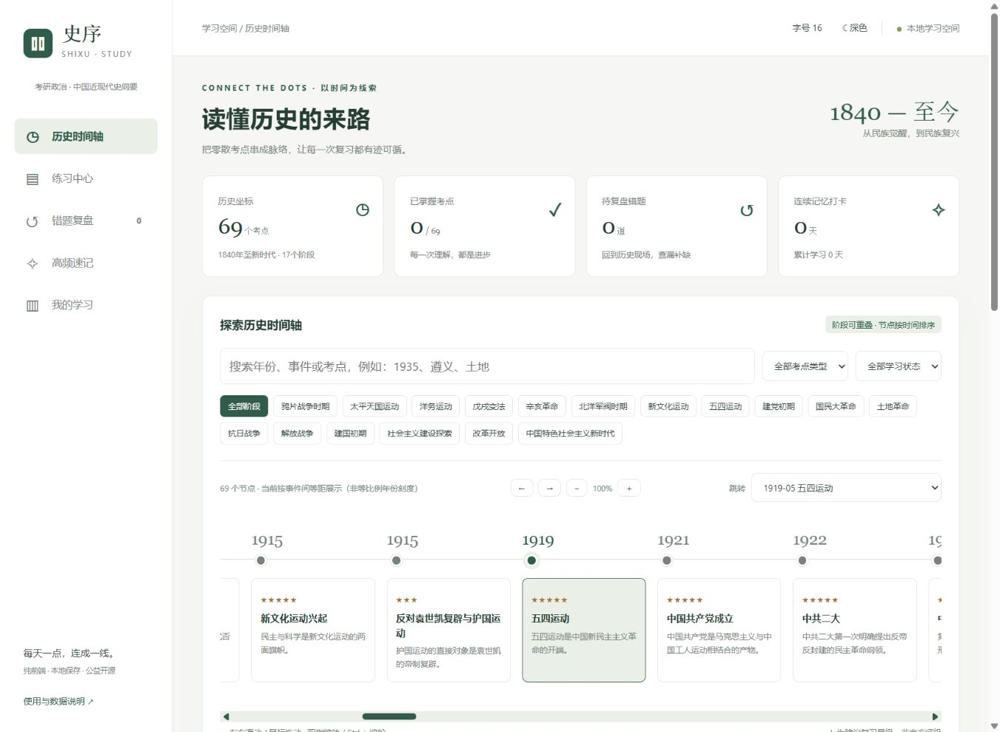
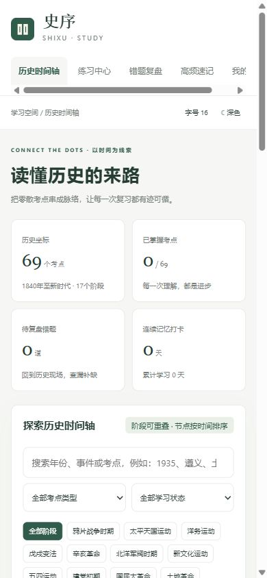
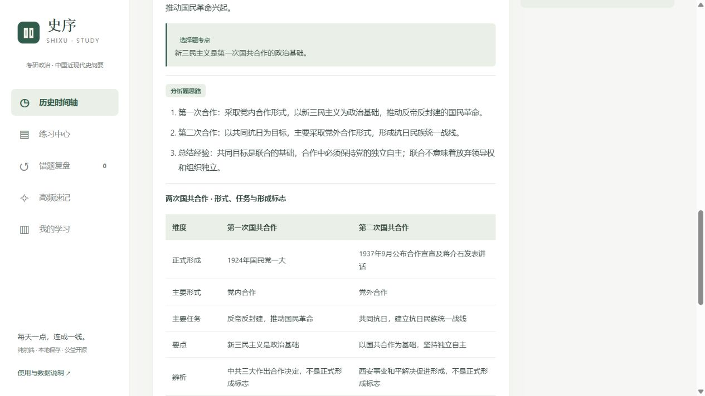
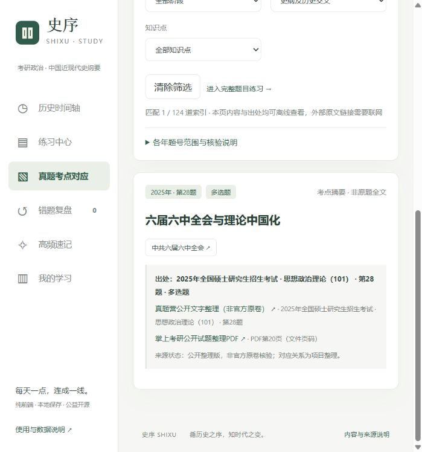

# 史序 SHIXU · 考研政治史纲交互式时间轴

**以时间为线，以理解为本。** 一个不依赖框架、账号或后端的中国近现代史复习工具。下载源码，解压后直接打开 `index.html` 即可学习；也可部署为静态网站。

纯 HTML + CSS + JavaScript · 零运行依赖 · 本地记录 · 明暗主题 · MIT

**在线学习：[GitHub Pages](https://wenjialei15.github.io/shigang-timeline/)** · **源码：[GitHub 仓库](https://github.com/wenjialei15/shigang-timeline)**

> 当前版本提供 **90个事件节点、17个阶段、98道原创练习、124道历年题号—考点索引、10组速记**。索引覆盖2010—2025年16个试卷年份，含56道单选、52道多选、16道分析题，其中24道为历史交叉考点；分析题两小问分别对应。**索引依据公开整理版，不是原题全文库、官方答案或官方逐题学科审定。** 真题原文仍须通过有权使用的题库导入后作答；官方考纲逐条映射与超纲审校尚未完成。

**直接查看：[2010—2025逐题对应表（每题附出处）](docs/EXAM_MAP_2010_2025.md)** · [CSV](docs/exam-map-2010-2025.csv) · [JSON](docs/exam-map-2010-2025.json)

## 界面预览






实际浏览器截图；手机图来自390像素同源iframe的响应式预览裁切，非实体手机截图。测试学习记录不随源码分发。

## 可以做什么

- **把历史连起来**：覆盖鸦片战争、太平天国、洋务、维新、辛亥、北洋、新文化、五四、建党、大革命、土地革命、抗战、解放、建国、社会主义建设探索、改革开放和新时代。
- **围绕考点复习**：背景、经过、意义、选择题考点、分析题思路、易错辨析；四次探索、两次合作等横向比较。
- **具体展开核心分析点**：24个核心事件补充三点式学习论据；四次探索、两次合作和土地政策三组对比表可在相关节点直接查看。
- **双向探索时间轴**：鼠标拖动、滚轮、左右按钮与方向键；触屏横滑、双指缩放、缩放按钮、指定节点跳转。节点等距排列，不冒充等比例年份图。
- **精准检索**：四位年份按事件年份匹配，其他文字检索节点正文；叠加阶段、考点类型及收藏/掌握状态筛选。
- **形成个人复习路线**：收藏、重难点、掌握标记、逐事件笔记，输入自动保存，最多10000字。
- **练习与复盘**：章节、随机、用户导入年份套卷；单选、多选即时判定，分析题对照参考要点自评。答错入本，重做答对移出；历史记录保留。
- **历年真题对考点**：124道索引逐题关联知识点，年份、题号、题型、来源名称与链接紧跟题目摘要显示；PDF对照页有实际文件页码时一并标出。可按年份、题型、阶段、节点和关键词筛选，并从时间轴反向查看历年关联。
- **看见学习积累**：记忆打卡、连续天数、阶段掌握比例、客观题正确率；自评与客观统计分开。
- **学习记录自己保管**：JSON备份恢复、节点ID清单导出、题库导入、存储失败提示、损坏存档保护和跨标签冲突提示。
- **题库收录可检查**：按2010—2025年分题型统计、节点关联缺口、疑似重复年份题号提醒和JSON审计报告导出；统计不冒充官方核验。
- **长时间学习友好**：深浅主题，16/18/20字号，键盘焦点、语义标签、响应式布局。

## 立即运行

1. 下载仓库 ZIP 并**解压整个目录**。
2. 用现代浏览器打开 `index.html`。无需安装 Node、Python 或依赖包。
3. 从时间轴选取一个考点开始；在“我的学习”导出备份。

本地 HTTP 预览（可选，需 Python 3）：

```sh
python -m http.server 4173
```

打开 `http://localhost:4173`。需要检查源码时可使用 Node 22+ 运行：

```sh
node --test tests/*.test.cjs
```

完整步骤参见 [新手部署与使用](docs/USAGE.md)，数据格式见 [数据与题库规范](docs/DATA.md)。

## GitHub / Gitee 部署

**GitHub Pages 分支发布**：把本目录内容上传到仓库根目录，在 Settings → Pages 选择 Deploy from a branch，分支选择存放文件的分支、目录 `/ (root)`。无需构建。也可以选择 GitHub Actions，手动运行附带的 `Deploy GitHub Pages` 工作流，仅发布应用静态资源。

**Gitee 或其他静态托管**：上传相同文件，选择包含 `index.html` 的目录作为发布根目录。如账号下没有 Pages 服务，可用本地运行或任意静态托管；服务开放、认证及收费条件以平台实际提供为准。项目运行本身不依赖托管商。

所有资源使用相对路径，支持仓库子路径部署；没有API地址、CDN或远程字体需要配置。本仓库通过 GitHub Actions 发布到上方 Pages 地址，更新 main 分支后自动检查并部署，也支持手动运行工作流。

## 项目结构

```text
shigang-timeline/
├── index.html                  # 页面入口，经典脚本兼容file://
├── css/style.css               # 学术风响应式主题
├── js/core.js                  # 校验、日期、判题、转义等纯函数
├── js/app.js                   # 渲染、时间轴、练习、备份及持久化
├── data/history.js             # 阶段、事件、速记、史实参考、扩展注册表
├── data/review.js              # 24组分析要点、三组横向对比
├── data/questions.js           # 原创单选、多选、分析题
├── data/exams.js               # 2010—2025题号、考点、逐题出处、小问对应
├── assets/favicon.svg          # 本地标识
├── sw.js                       # HTTP(S)离线缓存
├── tests/core.test.cjs          # 无依赖自动化检查
├── tests/exams.test.cjs         # 索引范围、出处、关联时序与筛选检查
├── scripts/export-exam-map.cjs # 生成对应表Markdown / CSV / JSON
├── docs/                       # 使用、数据、架构、测试、项目展示文案
├── .github/workflows/          # 检查与手动Pages发布
├── CONTRIBUTING.md
├── CHANGELOG.md
└── LICENSE
```

## 内容来源与下一步

历史摘要、练习和速记为项目编写，参考入口包括 [近代史概览](https://www.locpg.gov.cn/zggq/2014-01/04/c_125956421.htm)、[中共中央党史和文献研究院百年大事记](https://www.nopss.gov.cn/n1/2021/0628/c219544-32142527.html) 和 [历次党代会资料](https://www.12371.cn/special/lcdh/)。[2027年思想政治理论考试大纲出版信息](https://xuanshu.hep.com.cn/front/book/findBookDetails?bookId=6aba9d37e119ac9729b837f9)可查阅，项目没有获得其完整正文并逐条审校。

欢迎按 [贡献指南](CONTRIBUTING.md) 校对史实、完善分析题、提供有权分发的真题及原卷出处。本版已建立公开整理版的124道对应索引；下一步是补足可分发的原题全文、官方原卷级复核与考纲版本映射，并扩大跨浏览器和真实触屏测试。毛中特、马原、思法已预留模块注册表，尚未实现对应课程界面。

## 数据与离线

知识点及原创题库随源码离线分发；个人记录和导入题库使用 `localStorage`。原始知识点不复制进有限的浏览器存储。直接打开文件时无需网络；HTTP(S)站点在首次联网打开并成功缓存后可离线访问。Service Worker 仅在 HTTPS 或 localhost 安全上下文中启用，直接打开文件不需要它。

浏览器清理、无痕模式、不同设备/域名/文件路径可能导致记录不可见或丢失，请定期备份。不能保证所有浏览器和设备零缺陷，已验证范围见 [测试记录](docs/TESTING.md)。

## 许可证

代码与项目原创学习内容采用 [MIT](LICENSE)。外部参考材料、第三方题目和用户导入文件不因本协议获得重新授权。学习工具不能代替报考年度官方大纲与正版教材。更新记录见 [CHANGELOG](CHANGELOG.md)。
